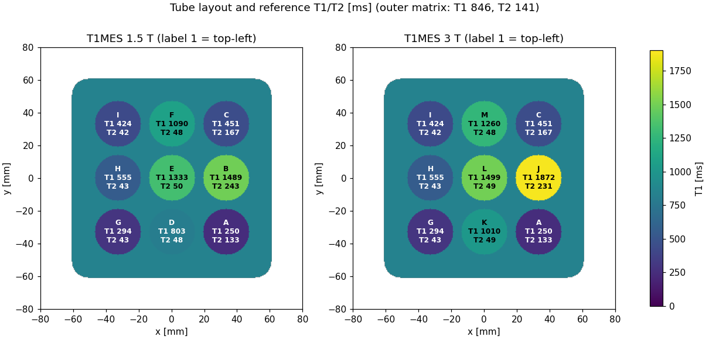
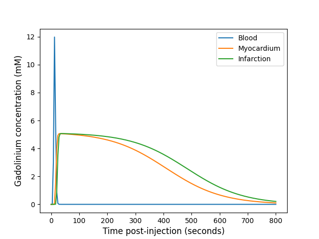

# T1MES

Digital version of the **T1MES phantom**, the cardiac T1 mapping quality-assurance phantom
of Captur et al. ([JCMR 2016, doi:10.1186/s12968-016-0280-z](https://doi.org/10.1186/s12968-016-0280-z)),
for the [MRzero](https://github.com/MRsources/MRzero-Core) MRI simulator.

The package builds:

- a **static phantom**: PD, T1, T2, T2′, D, B0, B1 and coil-sensitivity maps of the 1.5 T or 3 T
  T1MES phantom, saved as an `.npz` file that `MRzeroCore.VoxelGridPhantom.load` reads directly;
- a **dynamic phantom**: the same phantom with T1/T2 maps that change over time after a gadolinium
  (GBCA) injection, for `MRzeroCore.DynamicVoxelPhantom` (MRzeroCore fork, see [Install](#install));
- **contrast-agent concentration curves** of blood, myocardium and infarct with a Fermi model, used to
  drive the dynamic phantom.

B0, B1 and coil-sensitivity maps are generated with [mrtwin](https://github.com/INFN-MRI/mrtwin).


## Table of contents

- [Install](#install)
- [Quick start](#quick-start)
- [Phantom layout](#phantom-layout)
- [Command-line tools](#command-line-tools)
  - [`t1mes_build_static`](#t1mes_build_static)
  - [`t1mes_build_dynamic`](#t1mes_build_dynamic)
  - [`t1mes_simulate_fermi`](#t1mes_simulate_fermi)
- [JSON configuration](#json-configuration)
- [Python API](#python-api)
- [Output `.npz` and use in MRzero](#output-npz-and-use-in-mrzero)
- [Physics notes](#physics-notes)
- [Folder structure](#folder-structure)
- [Citation and license](#citation-and-license)

## Install

```bash
git clone https://github.com/CyprienBouton/T1MES
cd T1MES
conda create -n t1mes python=3.10      # or any Python >= 3.10 environment
conda activate t1mes

pip install .                # static phantom, MRzeroCore from PyPI
pip install ".[dynamic]"     # + dynamic phantom (MRzeroCore fork with DynamicVoxelPhantom)
```

The `dynamic` extra installs MRzeroCore from
`git+https://github.com/CyprienBouton/MRzero-Core.git@T1_T2_variable_v1.6`, a fork of MRzeroCore 1.6.1
that adds `DynamicVoxelPhantom`. Without it, everything works except loading, plotting and simulating
dynamic phantoms; `t1mes_build_dynamic --no-plot` still writes the dynamic `.npz` file.

Installing adds three commands: `t1mes_build_static`, `t1mes_build_dynamic` and `t1mes_simulate_fermi`.
Each one prints its options with `--help`.

## Quick start

```bash
# Static 2D phantom, 1.5 T, 128x128 matrix, 200x200 mm FOV, 5 mm slice
t1mes_build_static -FOV 200 200 5 -m 128 128 1 -o T1MES_1p5T.npz

# Dynamic phantom: 10 min of Fermi concentration curves, then T1/T2 over time
t1mes_simulate_fermi -d 600 -s 120 -o fermi.npz --no-plot
t1mes_build_dynamic -c fermi.npz -FOV 200 200 5 -m 128 128 1 -o T1MES_dynamic.npz
```

## Phantom layout

The phantom is a rounded block of gel (outer matrix, 122 × 122 × 187 mm) holding nine tubes
(Ø 28 mm, 33 mm apart) on a 3 × 3 grid. The tubes are labelled 1–9 row by row from the top-left tube.
The 1.5 T and 3 T phantoms share the five post-contrast tubes (A, C, G, H, I) and differ by their four
native tubes:

| B0    | Row 1 (labels 1–3) | Row 2 (labels 4–6) | Row 3 (labels 7–9) |
|-------|--------------------|--------------------|--------------------|
| 1.5 T | I, F, C            | H, E, B            | G, D, A            |
| 3 T   | I, M, C            | H, L, J            | G, K, A            |



## Command-line tools

### `t1mes_build_static`

Builds a static phantom and saves it as `.npz`.

| Flag | Description | Default |
|------|-------------|---------|
| `-FOV X Y Z` | Field of view [mm] | `200 200 50` |
| `-r`, `--resolution X Y Z` | Voxel size [mm] | `1 1 5` |
| `-m`, `--matrix X Y Z` | Matrix size (voxels) | `200 200 10` |
| `-B0`, `--field_strength` | `1.5` or `3` [T]: selects the 1.5 T or 3 T phantom | `1.5` |
| `--ncoils` | Number of receive coils of the sensitivity maps | `8` |
| `--rotate_LR` / `--no-rotate_LR` | Rotate the phantom by 90° in the xy-plane (alias `--LR`) | off |
| `--param_json` | Tissue parameter file (see [JSON configuration](#json-configuration)) | packaged `T1MES_values.json` |
| `--b0_kwargs` | Extra arguments for `mrtwin.b0field()`, as `key=value` pairs or a JSON file | `b0range=(-200,200)` |
| `--b1_kwargs` | Extra arguments for `mrtwin.b1field()` | |
| `--sensmap_kwargs` | Extra arguments for `mrtwin.sensmap()` | |
| `-o`, `--output_file` | Output `.npz` file (aliases `-p`, `--phantom_file`) | `T1MES_default.npz` |
| `--plot` / `--no-plot` | Plot the phantom with MRzeroCore | on |
| `--plot_kwargs` | Extra arguments for the MRzeroCore plot method, e.g. `plot_slice='all'` | `time_unit='ms'` |

Only two of `-FOV`, `-r`, `-m` are needed: the third one is computed from `FOV = resolution × matrix`.
If only one is given, the default matrix (or the default FOV when only `-m` is given) is used for the
other one. Giving all three inconsistently is an error.

`key=value` values are parsed as Python literals, so tuples, numbers and quoted strings work.
Several pairs can follow one flag.

```bash
# 3 T phantom, 1.5 mm in-plane resolution, 3 slices of 8 mm
t1mes_build_static -B0 3 -r 1.5 1.5 8 -m 128 128 3 -o T1MES_3T.npz

# Stronger B0 inhomogeneity, custom B1 range, no plot
t1mes_build_static -FOV 200 200 5 -m 128 128 1 \
    --b0_kwargs "b0range=(-400,400)" --b1_kwargs "b1range=(0.7,1.1)" --no-plot

# Custom tissue values, all slices plotted
t1mes_build_static --param_json my_T1MES_values.json --plot_kwargs "plot_slice='all'"
```

### `t1mes_build_dynamic`

Builds a phantom whose T1/T2 change over time after contrast injection. It accepts all the flags of
`t1mes_build_static` (with default output `T1MES_dynamic_default.npz`), plus exactly one of:

| Flag | Description |
|------|-------------|
| `-c`, `--concentrations_file` | `.npz` file of gadolinium concentrations over time (output of `t1mes_simulate_fermi`). The post-GBCA tubes get the T1/T2 of their native counterpart, shortened by the contrast agent (see [Physics notes](#physics-notes)). |
| `--times_post M[:S] ...` | Time after injection of each frame, in **minutes** (`16`) or minutes:seconds (`16:30`). The T1/T2 time series are read from `--param_json`: list-valued `T1`/`T2` fields must have one value per frame, scalar fields stay constant. |

and, with `-c` only:

| Flag | Description | Default |
|------|-------------|---------|
| `--r1` | Longitudinal relaxivity [s⁻¹ mM⁻¹] (see known issue below) | `4.1e-3` |
| `--r2` | Transverse relaxivity [s⁻¹ mM⁻¹] (see known issue below) | `4.6e-3` |

Plotting (`--plot`, on by default) needs `MRzeroCore.DynamicVoxelPhantom`; without it the command
stops with an explanation before computing anything. Use `--no-plot` to only write the file.

```bash
# From Fermi concentration curves
t1mes_simulate_fermi -d 600 -s 120 -o fermi.npz --no-plot
t1mes_build_dynamic -c fermi.npz -FOV 200 200 5 -m 128 128 1 -o T1MES_dynamic.npz

# From T1/T2 time series stored in a JSON file (here: lists of 10 values)
t1mes_build_dynamic --param_json my_dynamic_values.json \
    --times_post 0 0:09 0:18 0:27 0:36 0:45 0:54 1:03 1:12 1:21 \
    -FOV 200 200 5 -m 128 128 1 --no-plot -o T1MES_simple_dynamic.npz
```

### `t1mes_simulate_fermi`

Computes blood, myocardium and infarct gadolinium concentrations with the Fermi model and saves them
as `.npz` (`c_art`, `c_myo`, `c_inf` [mM] and `times_post` [s]).

| Flag | Description | Default |
|------|-------------|---------|
| `-t_start`, `--time_start` | Start of the sampled window, after injection [s] | `0` |
| `-d`, `--duration` | Duration of the sampled window [s] | `300` |
| `-s`, `--nb_sampled` | Number of time points in the window | `300` |
| `--alpha_myo`, `--beta_myo` | Fermi α [s⁻¹] and β of the myocardium | `0.01`, `0.01` |
| `--alpha_inf`, `--beta_inf` | Fermi α [s⁻¹] and β of the infarct | `0.01`, `0.005` |
| `--lv_myo_shift`, `--lv_inf_shift` | Delay between left ventricle and myocardium / infarct [s] | `3`, `3` |
| `--contrast_dose` | Injected dose [mmol/kg] | `0.1` |
| `--is_stress` / `--no-is_stress` | Stress (3.5 ml/g/min) or rest (1.0 ml/g/min) myocardial blood flow | stress |
| `--time_step` | Time step of the internal convolution grid [s] | `0.2` |
| `--plot` / `--no-plot` | Plot the curves | on |
| `-o`, `--output_file` | Output `.npz` file | `concentration_fermi_default.npz` |

```bash
# 15 min at rest with a 0.075 mmol/kg dose, one point every 5 s
t1mes_simulate_fermi -d 900 -s 181 --no-is_stress --contrast_dose 0.075 -o fermi_rest.npz
```



## JSON configuration

The tissue parameters come from a JSON file (default: [`t1mes/T1MES_values.json`](t1mes/T1MES_values.json)).
It has one entry per tube ID (`A` to `M`) and one for the gel `OuterMatrix`:

```json
{
    "A": {
        "description": "Short post-GBCA blood",
        "PD": 1.0, "T1": 250, "T2": 133, "T2dash": 30, "D": 0, "chi": -9,
        "agarose": 0.244, "NiCl2": 5.547
    },
    "OuterMatrix": { "description": "Outer matrix gel fill", "PD": 0.5, "T1": 846, "...": "..." }
}
```

| Field | Unit | Meaning |
|-------|------|---------|
| `description` | – | Tube name. Used for the tissue-mask names in the `.npz` and, in the dynamic phantom, to find the native tube matching each post-GBCA tube, so keep the naming pattern (`Short/Medium/Long post-GBCA myocardium`, `Short/Long post-GBCA blood`, `<Short/Medium/Long> native myocardium <1.5 T/3 T>`, `Normal native blood <1.5 T/3 T>`). |
| `PD` | a.u. | Relative proton density (tubes 1.0, outer matrix 0.5). |
| `T1` | ms | Longitudinal relaxation time. A number, or for `t1mes_build_dynamic --times_post` a list with one value per frame. |
| `T2` | ms | Transverse relaxation time. Number or list, as `T1`. |
| `T2dash` | ms | Reversible dephasing time T2′. |
| `D` | 10⁻³ mm²/s | Diffusion coefficient (0: diffusion ignored). |
| `chi` | ppm | Magnetic susceptibility, used by `mrtwin.b0field` to compute the B0 map. |
| `agarose`, `NiCl2` | – | Gel recipe of the tube (Captur et al. 2016). Informational only, not used by the code. |

The packaged T1/T2 values are the reference values of the T1MES tubes (Captur et al. 2016).
`PD`, `T2dash`, `D` and `chi` are modelling choices, not measured values.

Experiment-specific parameter files are kept in [`configs/`](configs/README.md).

## Python API

```python
from t1mes.build_static_phantom import build_static_phantom
from t1mes.build_dynamic_phantom import build_dynamic_phantom
from t1mes.concentration_models.fermi_concentration import get_concentrations
import numpy as np

# Static phantom; returns the saved arrays
maps = build_static_phantom(
    FOV=(200, 200, 5), matrix=(128, 128, 1), field_strength=3.0,
    b0field_kwargs={"b0range": (-300, 300)},
    phantom_file="T1MES_3T.npz", plot=False,
)

# Fermi concentrations, then dynamic phantom
t = np.linspace(0, 600, 121)                      # [s]
c_art, c_myo, c_inf = get_concentrations(t, alpha_myo=0.01, beta_myo=0.01,
                                         alpha_inf=0.01, beta_inf=0.005,
                                         contrast_dose=0.1, plot=False)
np.savez("fermi.npz", c_art=c_art, c_myo=c_myo, c_inf=c_inf, times_post=t)
build_dynamic_phantom(concentrations_file="fermi.npz", FOV=(200, 200, 5),
                      matrix=(128, 128, 1), phantom_file="T1MES_dynamic.npz", plot=False)
```

Lower-level helpers: `t1mes.generate_mask.create_t1mes_phantom_mask` (labelled geometry),
`t1mes.compute_dynamic_parameters.get_T1_T2_over_time` (T1/T2 time series per tube) and
`t1mes.phantom_utils` (field maps, tissue masks, plotting).

## Output `.npz` and use in MRzero

| Key | Shape | Unit |
|-----|-------|------|
| `PD_map` | (x, y, z) | a.u. |
| `T1_map`, `T2_map` | (x, y, z), or (t, x, y, z) for the dynamic phantom | s |
| `T2dash_map` | (x, y, z) | s |
| `D_map` | (x, y, z) | 10⁻³ mm²/s |
| `B0_map` | (x, y, z) | Hz |
| `B1_map` | (x, y, z) | relative flip angle (1 = nominal) |
| `coil_sens` | (ncoils, x, y, z) | complex, a.u. |
| `FOV` | (3,) | m |
| `time_points` | (t,) — dynamic phantom only | s after injection |
| `tissue_<description>` | (x, y, z) | boolean mask of each tube and of `tissue_OuterMatrix` |

Static phantom with MRzeroCore ≥ 1.6:

```python
import numpy as np
import torch
import MRzeroCore as mr0

phantom = mr0.VoxelGridPhantom.load("T1MES_1p5T.npz")   # voxel grid centred on the origin
# VoxelGridPhantom.load ignores coil_sens (uses a single uniform coil); to use the mrtwin coils:
phantom.coil_sens = torch.as_tensor(np.load("T1MES_1p5T.npz")["coil_sens"], dtype=torch.complex64)

phantom.plot()
print(phantom.tissue_masks.keys())                       # one mask per tube
data = phantom.build()

seq = mr0.Sequence.import_file("my_t1_mapping.seq")      # Pulseq sequence
graph = mr0.compute_graph(seq, data, 200, 1e-3)
signal = mr0.execute_graph(graph, seq, data)
```

Dynamic phantom (MRzeroCore fork): `mr0.DynamicVoxelPhantom.load("T1MES_dynamic.npz")` reads the same
keys plus `time_points`; T1/T2 are interpolated in time when the phantom is built for a sequence
(`phantom.build(repetition_times, start_time)` in the fork's `T1_T2_variable` branch), and
`phantom.plot_dynamic()` animates the maps.

## Physics notes

- **Geometry.** Approximate dimensions of the device; tubes are cylinders along z, restricted to the
  z-extent of the gel block. In-plane voxels are assumed square.
- **B0 / B1 / coils.** `mrtwin.b0field` computes the susceptibility-induced off-resonance from the `chi`
  map and rescales it to `b0range` (default ±200 Hz); `mrtwin.b1field` and `mrtwin.sensmap` generate
  smooth transmit-field and receive-coil maps. See the [mrtwin documentation](https://infn-mri.github.io/mrtwin/)
  for their parameters.
- **Contrast agent and relaxivity.** In the dynamic phantom built from concentrations, each post-GBCA
  tube starts from its native counterpart (e.g. "Short post-GBCA myocardium" → "Short native myocardium
  1.5 T"; blood tubes → "Normal native blood") and follows the fast-exchange model
  `1/T1(t) = 1/T1,native + r1·C(t)` (same for T2 with r2). **Known issue:** the defaults
  r1 = 4.1e-3 and r2 = 4.6e-3 s⁻¹ mM⁻¹ are kept for reproducibility of existing phantoms, but they are
  ~1000× smaller than published values for gadopentetate in plasma at 1.5 T (4.1 / 4.6 s⁻¹ mM⁻¹,
  Rohrer et al., Invest Radiol 2005), so the contrast effect is very weak. Using the published values
  with the current Fermi curves gives unrealistic T1 (~50 ms in myocardium): the concentration model
  needs calibration first. Use `--r1/--r2` to override. Phantoms built from JSON time series are not affected.
  Blood tubes follow the arterial curve, "Long post-GBCA myocardium" the infarct curve and the other
  myocardium tubes the myocardium curve. Native tubes and the outer matrix are constant.
- **Fermi model.** Tissue concentration is the arterial input function (AIF) convolved with a Fermi
  impulse residue function (Jerosch-Herold et al., Med Phys 1998):
  `C_tissue(t) = MBF · (C_art ⊛ R)(t − shift)`, `R(t) = (1 + β) / (1 + β·exp(α·t))`, with
  MBF = 1.0 (rest) or 3.5 (stress) ml/g/min. The AIF is the MRXCAT first-pass gamma-variate
  (Wissmann et al., JCMR 2014) scaled to a 12 mM peak for 0.1 mmol/kg and linearly with dose.
  It has no recirculation, so the arterial concentration returns to 0 about 45 s after injection.

## Folder structure

```
T1MES/
├── t1mes/
│   ├── T1MES_values.json            # reference tissue parameters (packaged)
│   ├── build_static_phantom.py      # t1mes_build_static
│   ├── build_dynamic_phantom.py     # t1mes_build_dynamic
│   ├── compute_dynamic_parameters.py# T1/T2 over time (relaxivity model or JSON time series)
│   ├── generate_mask.py             # labelled phantom geometry
│   ├── phantom_utils.py             # field maps, tissue masks, MRzero plotting
│   ├── convert_arguments.py         # shared CLI arguments and helpers
│   └── concentration_models/
│       └── fermi_concentration.py   # t1mes_simulate_fermi
├── configs/                         # experiment-specific parameter files (see configs/README.md)
├── visuals/                         # figures used in this README
├── pyproject.toml
├── LICENSE
└── README.md
```

## Citation and license

If you use this phantom, please cite the T1MES publication:
Captur G. et al., *A medical device-grade T1 and ECV phantom for global T1 mapping quality assurance —
the T1 Mapping and ECV Standardization in cardiovascular magnetic resonance (T1MES) program*,
J Cardiovasc Magn Reson 18, 58 (2016), [doi:10.1186/s12968-016-0280-z](https://doi.org/10.1186/s12968-016-0280-z).

Released under the [MIT license](LICENSE).
