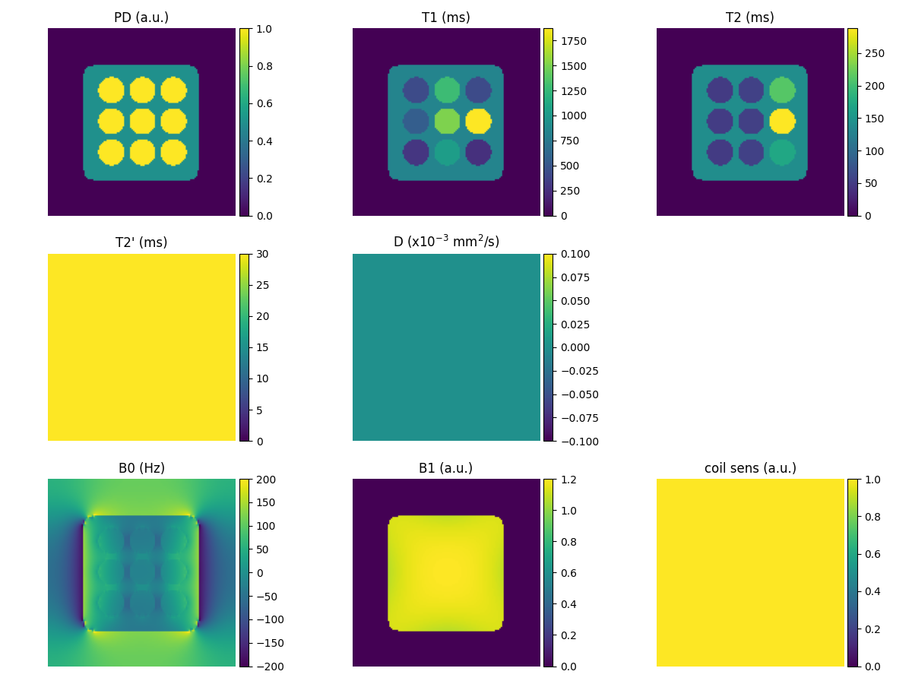

# T1MES
Python code to create a T1MES Phantom (See the publication [10.1186/s12968-016-0280-z](https://doi.org/10.1186/s12968-016-0280-z) for more details).<br>
B0 and B1 field are generated with the package [mrtwin](https://infn-mri.github.io/mrtwin/) (see related github repository [here](https://github.com/INFN-MRI/mrtwin))

# Table of Contents

- [Install](#install)
- [⚙️ Build Static T1MES Phantom](#️-build-static-t1mes-phantom)
- [📈 Build Dynamic T1MES Phantom](#-build-dynamic-t1mes-phantom)
- [🧪 Simulate Contrast Agent Concentration with Fermi Model](#-simulate-contrast-agent-concentration-with-fermi-model)

## Install

1. Download the repository:
   ```bash
   # clone project
   git clone https://github.com/CyprienBouton/T1MES
   cd T1MES
   ```
2. Create a virtual environment (Conda is strongly recommended):
   ```bash
   # create conda environment
   conda create -n T1MES python=3.10
   conda activate T1MES
   ```
4. Install the project and its dependencies:
   ```bash
   pip install .
   ```

Several new commands will be added to the virtual environment once the installation is completed.
These commands all start with `t1mes_`.

##  ⚙️ Build Static T1MES Phantom
Create a static phantom with the command `t1mes_build_static`.<br>
Here are the available flags: 

| **Flag**                  | **Description** |
|---------------------------|-----------------|
| `-FOV`                    | Field of View of the phantom in millimeters. <br>**Example:** `-FOV 200 200 200` <br>**Default:** `(200, 200, 200)` |
| `-r`, `--resolution`      | Resolution of the phantom (number of voxels per dimension). <br>**Example:** `-r 128 128 5` <br>**Default:** `(128, 128, 5)` |
| `-B0`, `--field_strength` | Static field strength in Tesla. <br>**Example:** `-B0 1.5` <br>**Default:** `1.5` |
| `-PD`                     | Proton density values for `'tubes'` and `'OuterMatrix'`, comma-separated. <br>**Example:** `-PD 1.0,0.5` |
| `-chi`                    | Susceptibility values for `'tubes'` and `'OuterMatrix'`, comma-separated. <br>Use `=` and quotes to avoid issues with negative signs. <br>**Example:** `-chi="-9.,-8."` |
| `-D`                      | Diffusion coefficients for `'tubes'` and `'OuterMatrix'`, comma-separated. <br>**Example:** `-D 0.,0.` |
| `-p`, `--phantom_file`    | Output file path for the generated phantom in `.npz` format. <br>**Example:** `-p phantom.npz` |
| `--plot` / `--no-plot`    | Whether to visualize the generated phantom. <br>Use `--no-plot` to disable plotting. <br>**Default:** `True` |
| `-T2dash`                 | T2′ value (in seconds). <br>**Example:** `-T2dash 0.03` <br>**Default:** `0.03` |
| `--b0_kwargs`             | Additional key-value arguments passed to `mrtwin.b0field()`. <br>**Format:** `"key=value"` <br>**Example:** `--b0_kwargs "b0range=(-500, 500)"` |
| `--b1_kwargs`             | Additional key-value arguments passed to `mrtwin.b1field()`. <br>**Format:** `"key=value"` <br>**Example:** `--b1_kwargs "b1range=(-0.8, 1.2)"` |



##  📈 Build Dynamic T1MES Phantom
Create a static phantom with the command `t1mes_build_dynamic`.<br>
Here are the available flags: 

| **Flag**                  | **Description** |
|---------------------------|-----------------|
| `-c`, `--concentrations_file` | File containing contrast agent concentrations over time [mM] for injected tubes. <br>**Example:** `-c fermi.npz` <br>**Required:** `True`|
| `-FOV`                    | Field of View of the phantom in millimeters. <br>**Example:** `-FOV 200 200 200` <br>**Default:** `(200, 200, 200)` |
| `-r`, `--resolution`      | Resolution of the phantom (number of voxels per dimension). <br>**Example:** `-r 128 128 5` <br>**Default:** `(128, 128, 5)` |
| `-B0`, `--field_strength` | Static field strength in Tesla. <br>**Example:** `-B0 1.5` <br>**Default:** `1.5` |
| `-PD`                     | Proton density values for `'tubes'` and `'OuterMatrix'`, comma-separated. <br>**Example:** `-PD 1.0,0.5` |
| `-chi`                    | Susceptibility values for `'tubes'` and `'OuterMatrix'`, comma-separated. <br>Use `=` and quotes to avoid issues with negative signs. <br>**Example:** `-chi="-9.,-8."` |
| `-D`                      | Diffusion coefficients for `'tubes'` and `'OuterMatrix'`, comma-separated. <br>**Example:** `-D 0.,0.` |
| `-p`, `--phantom_file`    | Output file path for the generated phantom in `.npz` format. <br>**Example:** `-p phantom.npz` |
| `--plot` / `--no-plot`    | Whether to visualize the generated phantom. <br>Use `--no-plot` to disable plotting. <br>**Default:** `True` |
| `-T2dash`                 | T2′ value (in seconds). <br>**Example:** `-T2dash 0.03` <br>**Default:** `0.03` |
| `--b0_kwargs`             | Additional key-value arguments passed to `mrtwin.b0field()`. <br>**Format:** `"key=value"` <br>**Example:** `--b0_kwargs "b0range=(-500, 500)"` |
| `--b1_kwargs`             | Additional key-value arguments passed to `mrtwin.b1field()`. <br>**Format:** `"key=value"` <br>**Example:** `--b1_kwargs "b1range=(-0.8, 1.2)"` |

## 🧪 Simulate Contrast Agent Concentration with Fermi Model
Generate contrast agent concentrations over time using Fermi model with the command `t1mes_simulate_fermi`.<br>
Here are the available flags:

| **Flag**                    | **Description** |
|-----------------------------|-----------------|
| `-t_start`, `--time_start`  | Start time after injection [s]. <br>**Default:** `0.0` |
| `-d`, `--duration`          | Duration of the scan [s]. <br>**Default:** `300.0` (5 minutes) |
| `-s`, `--nb_sampled`        | Number of time points to sample. <br>**Default:** `100` |
| `--alpha_myo`               | Fermi model alpha parameter for myocardium. <br>**Default:** `0.01` |
| `--beta_myo`                | Fermi model beta parameter for myocardium. <br>**Default:** `0.01` |
| `--alpha_inf`               | Fermi model alpha parameter for infarction. <br>**Default:** `0.01` |
| `--beta_inf`                | Fermi model beta parameter for infarction. <br>**Default:** `0.005` |
| `--lv_myo_shift`            | Time shift between left ventricle and myocardium [s]. <br>**Default:** `3.0` |
| `--lv_inf_shift`            | Time shift between left ventricle and infarction [s]. <br>**Default:** `3.0` |
| `--contrast_dose`           | Contrast dose [mmol/kg]. <br>**Default:** `0.1` |
| `--is_stress` / `--no-is_stress` | Flag to indicate stress condition. <br>**Default:** `True` |
| `--time_step`               | Time step for computing concentration [s]. <br>**Default:** `0.2` |
| `--plot` / `--no-plot`      | Whether to plot the resulting concentration curves. <br>**Default:** `True` |
| `-o`, `--output_file`       | Output `.npz` file to save computed concentrations. <br>**Example:** `-o fermi.npz` <br>**Default:** `concentration_fermi_default.npz` |

